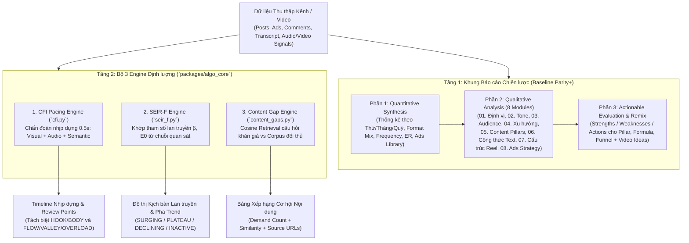

# Kế hoạch Phát triển Dự án CadenceLab (Next-Gen Social Intelligence & Pacing Lab)

> **Cập nhật ngày 07/11/2026:**
> - **Đổi tên thương hiệu:** Đổi từ *SocialLens Pro* sang **CadenceLab** (nhấn mạnh thuật toán nhịp độ `Cadence / CFI 0.5s` và phòng thí nghiệm chiến lược nội dung).
> - **Kiến trúc Database Local-First:** Mở rộng SQLite local (`.sociallens/jobs.sqlite3` ở chế độ WAL) để lưu trữ đầy đủ `jobs`, `channels`, `posts`, `post_snapshots`, và `reports` chạy độc lập 100% không phụ thuộc cloud.
> - Đồng bộ hóa kết quả tối ưu hóa 3 Engine thuật toán ([`docs/research/OPTIMIZATION_2026-10-31.md`](research/OPTIMIZATION_2026-10-31.md)), pipeline báo cáo 3 phần + Codex Local AI ([`docs/BACKEND_INTEGRATION.md`](BACKEND_INTEGRATION.md), [`docs/CODEX_LOCAL_WORKFLOW.md`](CODEX_LOCAL_WORKFLOW.md)) và giao diện chuẩn Hallmark Dusk (`apps/web/`).

---

## 1. Chiến lược Sản phẩm: "Kế thừa Đóng gói Thực dụng + Vượt trội Lõi Định lượng"

Qua việc bóc tách mã nguồn client của `sociallens.co.in`, chúng ta xác định rõ công thức chiến thắng cho **SocialLens Pro**:
1. **Giữ trọn vẹn cấu trúc Báo cáo 3 Phần (Structured Marketing Reports) mà khách hàng đang sẵn sàng trả tiền:**
   - Báo cáo Kênh (`Channel Report`), Báo cáo 1 Video lẻ (`Single Video Inspector`), So sánh Đối thủ (`1-vs-1 Competitor`), và Gộp Đa kênh (`Cross-channel Merge: FB + TikTok + IG + YT`).
   - Quét Quảng cáo đang chạy (Facebook Ads Library) và xuất báo cáo `.pdf` / `.docx` song ngữ Việt - Anh.
2. **Thay thế hoàn toàn hạ tầng `n8n` chậm chạp (30–45 giây/bài) bằng FastAPI Async Pipeline:**
   - Gọi song song các tác vụ bóc tách dữ liệu và LLM Structured Output (Pydantic Schema), truyền kết quả theo thời gian thực qua Server-Sent Events (SSE).
3. **Bổ sung 3 Engine Định lượng (`packages/algo_core`) vào đúng chỗ đối thủ chỉ dùng LLM đoán chữ:**
   - Thay vì mục *"07. Công thức Reel"* chỉ đọc văn bản lời thoại (`transcript_analysis`), ta cung cấp thêm **Timeline Chẩn đoán Nhịp dựng CFI 0.5s** (`visual_motion`, `acoustic_flux`, `semantic_density`).
   - Thay vì nhận xét xu hướng cảm tính bằng chữ, ta cung cấp **Mô hình Khớp Chuỗi Lan truyền SEIR-F** từ dữ liệu quan sát thực tế.
   - Thay vì tự nghĩ ra ý tưởng chung chung, ta dùng **Demand-Backed Content Gaps** đối chiếu câu hỏi thực tế trong bình luận/search (kèm link dẫn chứng) với kho bài đăng của đối thủ bằng Cosine Similarity.

---

## 2. Kiến trúc 2 Tầng Phân tích: Structured LLM + Quantitative Engines



### 2.1. Engine 1: `CFI Pacing Diagnostics` ([`packages/algo_core/cfi.py`](../packages/algo_core/cfi.py))
* **Vai trò:** Chẩn đoán nhịp dựng vi mô từng lát cắt $\Delta t = 0.5\text{s}$ để biên tập viên phát hiện các đoạn tĩnh kéo dài hoặc quá tải tín hiệu.
* **Cơ chế toán học:**
  - Tính đạo hàm theo giây: $\Delta V(t) = \text{clip}(|\nabla_t V(t)|, 0, 1)$, $\Delta A(t) = \text{clip}(|\nabla_t A(t)|, 0, 1)$.
  - Tổ hợp tín hiệu chuẩn hóa $[0, 1]$ và giảm trừ độ dư thừa $R(t) = 1 - \max(V(t), A(t), S(t))$ (giúp bảo vệ các video talking-head có góc máy tĩnh nhưng mật độ ngữ nghĩa $S(t)$ cao):
    $$\text{CFI}(t) = \text{clip}\Bigl(w_v \cdot \frac{V(t) + \Delta V(t)}{2} + w_a \cdot \frac{A(t) + \Delta A(t)}{2} + w_s \cdot S(t) - w_r \cdot R(t),\; 0, 1\Bigr)$$
* **Đầu ra:** Điểm `cfi_score`, mức tải tín hiệu `stimulus_load`, nhãn giai đoạn `stage` (`HOOK` $0-3\text{s}$ độc lập với `BODY`), nhãn vùng `zone` (`FLOW`, `BOREDOM_VALLEY`, `OVERLOAD`), và danh sách mốc giây bắt đầu của từng đoạn cần xem lại (`review_points`). *(Lưu ý: `predicted_completion_rate` giữ ở trạng thái `None` / `not_calibrated` cho tới khi có tập dữ liệu retention thực tế).*

### 2.2. Engine 2: `SEIR-F Conditional Trend Model` ([`packages/algo_core/seir_f.py`](../packages/algo_core/seir_f.py))
* **Vai trò:** Mô hình hóa động lực học lan truyền xu hướng và khớp tham số có điều kiện từ chuỗi số lượng người lan truyền hoạt động theo ngày (`daily_active_spreaders`).
* **Cơ chế toán học:**
  - Bảo toàn chặt chẽ tổng quy mô dân số $S(t) + E(t) + I(t) + R(t) = N$ tại mọi thời điểm $t \ge 0$:
    $$\frac{dS}{dt} = -\frac{\beta S I}{N}, \quad \frac{dE}{dt} = \frac{\beta S I}{N} - \sigma E, \quad \frac{dI}{dt} = \sigma E - \left(\gamma + \alpha \frac{F}{N}\right) I, \quad \frac{dR}{dt} = \left(\gamma + \alpha \frac{F}{N}\right) I, \quad \frac{dF}{dt} = I - \kappa F$$
  - Khớp tham số $(\beta, E_0)$ từ 7–365 ngày quan sát bằng `scipy.optimize.least_squares` (`soft_l1` loss trên miền $\ln(1+I)$).
* **Đầu ra:** Dự báo tương lai `day = 1..days`, `active_virality` ($I/N$), `audience_fatigue` ($F/N$), tốc độ tăng trưởng tức thời `growth_rate`, pha xu hướng (`SURGING`, `PLATEAU`, `DECLINING`, `INACTIVE`) và bộ chỉ số khớp mẫu (`training_mae`, `training_log_rmse`, `fixed_priors`).

### 2.3. Engine 3: `Demand-Backed Semantic Content Gaps` ([`packages/algo_core/content_gaps.py`](../packages/algo_core/content_gaps.py))
* **Vai trò:** Xếp hạng các câu hỏi/nhu cầu có thật của khán giả mà kho nội dung hiện tại của đối thủ chưa giải quyết thỏa đáng.
* **Cơ chế toán học:**
  - Chuẩn hóa L2 toàn bộ vector bài viết (`embeddings`) và vector câu hỏi (`unanswered_queries`), khử trùng lặp câu hỏi theo chuỗi chuẩn hóa (lấy `max(demand_count)` thay vì cộng dồn).
  - Loại bỏ các câu hỏi đã được phủ ($\text{best\_sim} \ge 0.8$) và chấm điểm ưu tiên cho các khoảng trống còn lại:
    $$\text{Opportunity Score} = \frac{\text{demand\_count}}{\text{demand\_count} + 20} \times \bigl(1 - \max(0, \text{best\_sim})\bigr)$$
* **Đầu ra:** Top khoảng trống nội dung kèm `query`, `demand_count`, `nearest_content_similarity`, 3 cụm chủ đề gần nhất (`bounding_clusters`) và danh sách link dẫn chứng (`supporting_sources`).

---

## 3. Phân công Trách nhiệm & Tiêu chuẩn Kỹ thuật

```mermaid
flowchart LR
    subgraph Anti ["🎨 ANTIGRAVITY (Frontend & Hallmark Design)"]
        UI1["Next.js 15 App Router + Design Tokens (`tokens.css`)"]
        UI2["Bộ Báo cáo Chiến lược 8 Phần (Channel / Single / Comp / Merge)"]
        UI3["Trình kiểm tra Video CFI Timeline (Stage + Zone + Review Points)"]
        UI4["Bảng Dự báo & Khớp chuỗi SEIR-F (Fit Diagnostics + Trajectory)"]
        UI5["Bảng Xếp hạng Content Gaps (Demand Evidence + Source Links)"]
        UI6["Kiểm duyệt UI chống AI-Slop (`sloplint.mjs --render`)"]
    end

    subgraph Codex ["⚙️ CODEX (Backend, Pipeline & Algo Core)"]
        BE1["FastAPI v0.2.0 (`StrictRequest` + HTTP 422 Validation)"]
        BE2["Async Scraper & Structured LLM Pipeline (Pydantic JSON Schema)"]
        BE3["Module `cfi.py`, `seir_f.py`, `content_gaps.py` (`packages/algo_core`)"]
        BE4["Video/Audio Feature Extractor (OpenCV + librosa + Transcript)"]
        BE5["Export Engine (`.pdf` / `.docx` song ngữ Việt - Anh)"]
        BE6["Bộ 26 Regression & API Integration Tests (`tests/test_algorithms.py`)"]
    end

    Anti <-->|REST API + SSE Stream| Codex
```



---

## 4. Lộ trình Triển khai Cập nhật (4 Giai đoạn)

| Giai đoạn | Hạng mục Trọng tâm | Nhiệm vụ của Antigravity (Frontend & UI/UX) | Nhiệm vụ của Codex (Backend & Algo) |
| :--- | :--- | :--- | :--- |
| **Giai đoạn 1: Core Engines & Giao diện Chẩn đoán (Hiện tại)** | Hoàn thiện lõi thuật toán `v0.2.0` & dựng UI cho 3 Engine | Khởi tạo `apps/web` (Next.js 15) theo chuẩn **Hallmark** (Design Tokens, chống AI-slop); xây dựng giao diện tương tác cho `/cfi/analyze`, `/trend/forecast`, `/whitespaces/discover`. | Hoàn tất tối ưu `cfi.py`, `seir_f.py`, `content_gaps.py`, FastAPI `v0.2.0` và 26 bài kiểm thử tự động (**Đã hoàn thành 100%**). |
| **Giai đoạn 2: Báo cáo 1 Video & Báo cáo Kênh 8 Phần** | Vượt qua trải nghiệm báo cáo của `sociallens.co.in` | Dựng UI **Single Video Report** (Metrics, ER/Value/Viral Score, Hook-Body-CTA, CFI Timeline) và **Channel Report** (Biểu đồ tương tác, Ads Library, 8 mục Accordion `01`–`08`, bảng Strengths/Weaknesses/Actions). | Xây dựng pipeline bóc tách dữ liệu kênh/video + chạy song song các prompt LLM Structured Output (thay thế n8n) + trích xuất feature thật từ file video cho CFI. |
| **Giai đoạn 3: So sánh Đối thủ, Gộp Đa kênh & Remix Studio** | Mở rộng đa nền tảng & sinh kịch bản hành động | Dựng UI **1-vs-1 Competitor Comparison**, **Cross-channel Merge** (FB + TikTok + IG + YT) và **AI Content Remix Studio** (tạo kịch bản cải tiến từ `video_ideas` và `content_gaps`). | Xây dựng endpoint tổng hợp đa kênh, gom cụm chủ đề tự động, trích xuất câu hỏi từ bình luận thật để cấp dữ liệu cho `ContentGapEngine`. |
| **Giai đoạn 4: Xuất Báo cáo, Thanh toán & Vận hành** | Đóng gói thương mại hóa | Trang quản lý Job/Report, nút tải xuống `.pdf`/`.docx` song ngữ, chia sẻ báo cáo công khai, tích hợp thanh toán VietQR (SePay/PayOS) & Affiliate Dashboard. | Dịch vụ render báo cáo PDF/Docx tốc độ cao, webhook thanh toán tự động, xác thực người dùng, phân quyền CORS và tối ưu tải. |

---

## 5. Cấu trúc Dự án Chuẩn hóa (Monorepo)

```text
sociallens-pro/
├── apps/
│   ├── web/                              # Frontend (Next.js 15 - Antigravity, chuẩn Hallmark)
│   │   ├── src/
│   │   │   ├── app/                      # Routes: /dashboard, /reports, /single-inspector, /gaps
│   │   │   ├── components/
│   │   │   │   ├── report-viewer/        # Bộ hiển thị báo cáo 3 phần (Accordion 01-08, Charts, Ads)
│   │   │   │   ├── cfi-inspector/        # Timeline nhịp dựng 0.5s (Hook/Body, Flow/Valley/Overload)
│   │   │   │   ├── trend-forecaster/     # Đồ thị SEIR-F & bảng thông số fit từ chuỗi quan sát
│   │   │   │   └── content-gaps/         # Bảng xếp hạng câu hỏi nhu cầu & nguồn dẫn chứng
│   │   │   └── styles/tokens.css         # Hệ thống Design Tokens tuân thủ Hallmark Floor
│   └── api/                              # Backend (FastAPI v0.2.0 - Codex)
│       ├── main.py                       # API Gateway: /cfi/*, /trend/*, /whitespaces/discover
│       ├── app/                          # Modules: scrapers, llm_structured, exporters
│       └── workers/                      # Async task workers
├── packages/
│   ├── algo_core/                        # Thư viện thuật toán chuẩn hóa (Canonical Python Package)
│   │   ├── cfi.py                        # CFIEngine: Chẩn đoán nhịp dựng video theo giây
│   │   ├── seir_f.py                     # SEIRFEngine: Giải & khớp hệ vi phân SEIR-F bảo toàn dân số
│   │   ├── content_gaps.py               # ContentGapEngine: Truy xuất khoảng trống ngữ nghĩa có dẫn chứng
│   │   └── tda_whitespace.py             # Alias tương thích ngược
│   ├── algo-core/                        # Shim tương thích đường dẫn cũ
│   └── types/                            # Shared contracts (Pydantic / TypeScript)
├── tests/
│   └── test_algorithms.py                # 26 bài kiểm thử hồi quy cho 3 Engine & FastAPI endpoints
├── docs/
│   ├── PROJECT_CONTEXT.md                # Bối cảnh dự án & kết quả bóc tách đối thủ
│   ├── PLAN.md                           # Kế hoạch phát triển tổng thể (file này)
│   └── research/                         # Báo cáo kiểm chứng toán học & dữ liệu probe
├── pyproject.toml                        # Khai báo dependencies chuẩn (uv)
└── uv.lock
```

---

## 6. Kiến trúc Cơ sở Dữ liệu SQLite Local-First (`.sociallens/jobs.sqlite3`)

Để hệ thống **CadenceLab** chạy độc lập 100% trên máy local mà không phụ thuộc vào dịch vụ đám mây bên ngoài, tầng lưu trữ sử dụng **SQLite ở chế độ `WAL` (`PRAGMA journal_mode=WAL`)**, quản lý khởi tạo qua `lifespan` trong [`apps/api/main.py`](../apps/api/main.py) và [`apps/api/services/jobs.py`](../apps/api/services/jobs.py).

### 6.1. Bảng đang hoạt động (`jobs`)
Lưu trữ hàng đợi tác vụ, khóa chống gửi trùng (`idempotency_key` + `fingerprint` SHA-256), cơ chế thuê bao worker (`lease_until` 300s + heartbeat 20s) và kết quả báo cáo 3 phần (`result` JSON):
- `id TEXT PRIMARY KEY`
- `idempotency_key TEXT UNIQUE`
- `fingerprint TEXT NOT NULL`
- `state TEXT NOT NULL` (`queued` | `running` | `completed` | `failed` | `cancelled`)
- `progress INTEGER NOT NULL`
- `payload TEXT NOT NULL` (JSON đầu vào `ReportRequest`)
- `result TEXT` (JSON đầu ra 3 phần `report_part_1`, `report_part_2`, `report_part_3`)
- `error TEXT`, `created REAL`, `updated REAL`, `lease_until REAL`, `attempts INTEGER`

### 6.2. Mở rộng Lược đồ SQLite Local (`channels`, `posts`, `post_snapshots`, `reports`)
Bước mở rộng tiếp theo ngay trong SQLite local để đối chiếu lịch sử tăng trưởng qua nhiều lần chụp (multi-snapshot) và tra cứu kho nội dung:
1. **`channels`**: `(platform, channel_id) PRIMARY KEY`, `name`, `url`, `first_seen_at`, `last_seen_at`.
2. **`posts`**: `(platform, channel_id, post_id) PRIMARY KEY`, `url`, `published_at`, `format`, `duration_seconds`, `caption`, `transcript`, `ad_text`.
3. **`post_snapshots`**: `(platform, channel_id, post_id, observed_at) PRIMARY KEY`, `views`, `likes`, `comments`, `shares` — cho phép tính tốc độ tăng trưởng thực tế $\Delta\text{views}/\Delta t$ giữa các lần nhập CSV/JSON.
4. **`reports`**: `id TEXT PRIMARY KEY`, `job_id TEXT REFERENCES jobs(id)`, `kind`, `analysis_mode`, `language`, `semantic_status`, `created_at REAL`.
